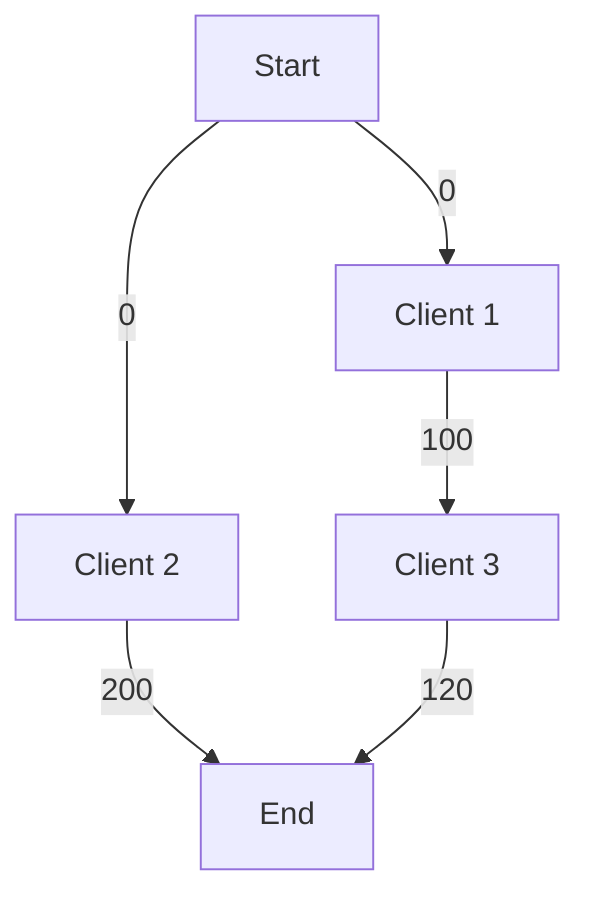

# Rental Scheduling Optimizer

A rental scheduling program that finds the most profitable combination of nonoverlapping booking requests for a single property. The project models client requests as a directed acyclic graph (DAG) and uses topological sorting with dynamic programming to calculate the maximum revenue and identify the clients included in the optimal schedule.

## The Problem

Each potential client provides a start date, an end date, and the amount they are willing to pay. Because only one client can use the property at a time, accepting one request may prevent the property owner from accepting another. The goal is to select a compatible set of requests whose combined revenue is as large as possible.

The program evaluates how requests fit together across the entire schedule. This allows it to find cases where accepting several smaller bookings earns more than accepting one larger booking.

## Input and Results

Client requests are read from a text file, with each line containing a request in the form:

```text
(start_date, end_date, revenue)
```

The program returns the maximum revenue and the set of clients whose bookings produce that revenue. A booking can begin on the same date that a previous booking ends: requests are compatible when `previous_end <= next_start`.

## How It Works

### 1. Construct the Graph

Each client request becomes a vertex. A directed edge connects client `i` to client `j` when client `i` finishes before or when client `j` begins. Each outgoing edge from a client carries that client's rental revenue as its weight.

Two additional vertices, `Start` and `End`, mark the schedule's boundaries. `Start` connects to clients with no incoming edges, and clients with no outgoing edges connect to `End`. Edges leaving `Start` have a weight of zero.

### 2. Sort the Vertices

Topological sorting places the vertices in an order that respects the graph's directed edges. Processing this order in reverse ensures that every client's possible next bookings have already been evaluated.

### 3. Calculate Maximum Revenue

Dynamic programming stores the best revenue obtainable from each vertex to `End`:

```text
F(End) = 0
F(v) = revenue(v) + max(F(next))
```

Here, `next` ranges over the outgoing neighbors of `v`, and `revenue(Start) = 0`. The final result is `F(Start)`. Computing each vertex's value once avoids the repeated calculations of a brute-force recursive approach.

### 4. Reconstruct the Schedule

While calculating revenue, the algorithm records the next vertex that gives the best result. Following these choices from `Start` to `End` recovers the selected clients in booking order.

## Example

| Client | Start Date | End Date | Revenue |
| --- | ---: | ---: | ---: |
| Client 1 | 10 | 40 | 100 |
| Client 2 | 20 | 70 | 200 |
| Client 3 | 50 | 80 | 120 |

Client 2 overlaps with both other requests. Clients 1 and 3 are compatible, so accepting both produces the optimal revenue of **220**, compared with **200** from Client 2 alone.

The corresponding weighted graph is:



The optimal path is `Start → Client 1 → Client 3 → End`, with a total weight of `0 + 100 + 120 = 220`.

## Complexity

For `n` client requests, constructing the graph by checking every pair takes **O(n²)** time. The graph contains `V = n + 2` vertices and can contain **O(n²)** edges.

With an adjacency list, topological sorting and the dynamic programming pass each take **O(V + E)** time. With an adjacency matrix, scanning neighbors takes **O(V²)** time per full traversal. Reconstructing the selected schedule takes **O(V)** time in the worst case.

The overall approach therefore takes **O(n²)** time when graph construction checks every pair. Graph storage can also require **O(n²)** space in the worst case; revenue values, next-vertex choices, and the topological order require **O(n)** additional space.

## Concepts Demonstrated

- Modeling scheduling constraints with a directed acyclic graph.
- Topological sorting and dependency ordering.
- Dynamic programming for the longest path in a DAG.
- Reconstructing an optimal solution from stored decisions.
- Analyzing time and space complexity.
